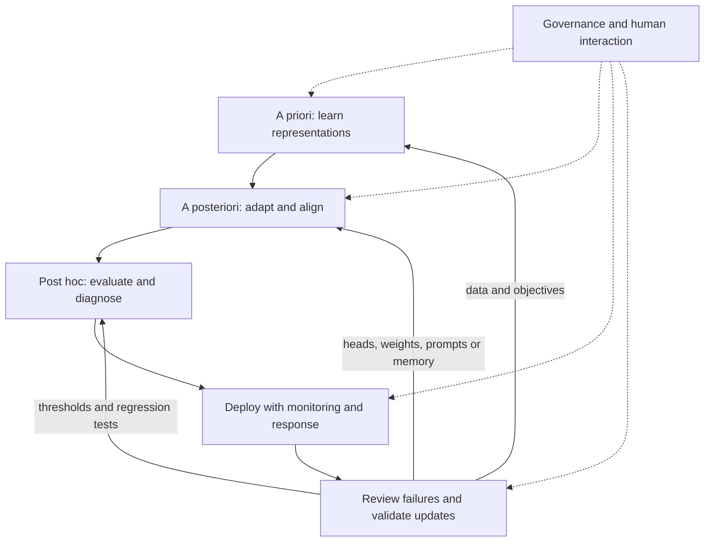

# Awesome Foundation Model Lifecycle

**Robustness from representation learning to adaptation, deployment, and feedback.**

A curated collection of papers, benchmarks, and research resources organized around **when and how robustness is introduced, evaluated, and maintained** in a foundation model's lifecycle. Covers vision, language, multimodal models, and the systems built around them.

Companion to **Robustness in Foundation Models: A Priori, A Posteriori, and Post-hoc Robustness**, by **Ghassan AlRegib and Mohit Prabhushankar**. The organizing framework comes from the supplied 2026 manuscript. Additional seminal works are marked **Added** throughout the list.

> Robustness is a lifecycle responsibility: representation choices constrain adaptation; adaptation changes what must be evaluated; deployment failures supply evidence for the next update.

**[Lifecycle guide](docs/lifecycle.md) · [Reading paths](docs/reading-paths.md) · [Benchmarks and metrics](docs/benchmarks.md) · [Case studies](docs/case-studies.md) · [Paper map](docs/paper-map.md) · [BibTeX](references.bib) · [Contribute](CONTRIBUTING.md)**

## Survey

| Item | Details |
| --- | --- |
| Authors | Ghassan AlRegib and Mohit Prabhushankar, Georgia Institute of Technology |
| Source edition | Supplied 2026 manuscript; 217 PDF pages, with printed text and references numbered 1–213 |
| Public paper | **TODO:** add the public manuscript or publisher landing-page URL |
| Publication metadata | **TODO:** replace the draft citation with the final publisher citation and DOI |
| Citation | [Draft BibTeX](docs/citation.md); [GitHub citation metadata](CITATION.cff) |
| Images | [Figure insertion plan](assets/figures/README.md), with exact figure and page numbers |

The draft cover contains placeholder publication fields, so no publisher volume, page range, or DOI is asserted here. The manuscript PDF and its figures are not bundled in this repository.

## The lifecycle at a glance

This is an original repository schematic interpreting the manuscript's lifecycle framework. **Figure 1.2 in the manuscript depicts three training stages—pretraining, task-head training, and alignment. Its last two stages both sit within the a posteriori paradigm; post hoc evaluation follows and can recur throughout deployment.**

| Paradigm | Main question | Main levers | Evidence handed to the next stage |
| --- | --- | --- | --- |
| **A priori** · Chapters 2–3 | What information will the representation retain? | Pretraining data, SSL objectives, tokenization, attention, fusion | Representation diagnostics, transfer results, data and checkpoint provenance |
| **A posteriori** · Chapters 4–5 | How should a pretrained model change for this task or user? | Heads, fine-tuning, PEFT, alignment, editing, prompts, retrieval, test-time adaptation | Task performance, capability preservation, edit locality, interaction sensitivity |
| **Post hoc** · Chapters 6–7 | When should a trained model's behavior be questioned? | Failure detection, red teaming, calibration, explanations, uncertainty | Scores, failure cases, abstention policies, monitoring and regression evidence |
| **Across the lifecycle** · Chapters 1 and 8 | Who acts on failures, and what improves after an update? | Continual learning, documentation, privacy, subgroup evaluation, human oversight | Validated updates, retained capabilities, incident ownership and recovery records |

**TODO — Figure 1.2:** insert the manuscript's training-stage diagram here after exporting it to `assets/figures/figure-1-2-training-stages.png`. See the [figure plan](assets/figures/README.md) for a ready-to-use insertion snippet.

## Start here

1. Read the [terminology and stage boundaries](docs/lifecycle.md), especially primary versus secondary robustness.
2. Follow a [12-paper introductory route or a specialist reading path](docs/reading-paths.md).
3. Choose an evaluation setting using the [benchmark matrix](docs/benchmarks.md).
4. Use the [manuscript case studies](docs/case-studies.md) to connect mechanisms across stages.

## Contents

- [Foundations and the learning–robustness tradeoff](#foundations)
- A priori robustness: [self-supervised learning](#ssl), [architectures and multimodal fusion](#architecture), [data and pretraining choices](#data)
- A posteriori robustness: [adaptation and interaction](#adaptation), [alignment](#alignment), [representation and model editing](#editing)
- Post hoc robustness: [failure detection](#detection), [red teaming](#redteaming), [transparency](#transparency), [uncertainty and calibration](#uncertainty)
- Across the lifecycle: [evaluation resources](#evaluation), [feedback and maintenance](#feedback), [socio-technical robustness](#governance)
- [Scope and curation](#scope-and-curation), [contributing](CONTRIBUTING.md), [publishing this repository](docs/publishing.md)

## How to read the list

**Survey §…** identifies where a work is discussed in the supplied manuscript. **Added** marks a complementary work selected for this repository. Placement reflects the **mechanism and intervention point**, not merely a paper's title or publication date. A benchmark can test several stages; a method can appear in one primary category while informing others.

Years refer to the listed conference, journal, or report when supplied; otherwise they refer to the linked preprint. A preprint may precede a conference version. The [machine-readable catalog](data/papers.json) records source checks and provenance. Short annotations explain relevance; they do not claim every method establishes a robustness guarantee.

<!-- BEGIN CATALOG -->
<!-- Generated by scripts/build_catalog.py; edit data/papers.json. -->

**138 works · 104 from the manuscript · 34 additions.** Initial primary-source checks: 2026-10-05 UTC. Subsequent checks are recorded per entry.

## Across the lifecycle: Foundations and the learning–robustness tradeoff

What should remain invariant, and what should change when the target changes?

- **[On the Opportunities and Risks of Foundation Models](https://arxiv.org/abs/2108.07258)** (arXiv, 2021). Frames reuse and homogenization: an upstream defect can propagate into many downstream systems. **[Survey §1.2, §1.3]**

- **[The Information Bottleneck Method](https://arxiv.org/abs/physics/0004057)** (arXiv version of 1999 work, 2000). Provides the compression and information-preservation lens used throughout the monograph; not a universal theory of all training dynamics. **[Survey §1.1, §2, §3]**

- **[Explaining and Harnessing Adversarial Examples](https://arxiv.org/abs/1412.6572)** (ICLR, 2015). A foundational account of adversarial vulnerability and adversarial training, motivating explicit perturbation models. **[Survey §1.1]**

- **[Towards Deep Learning Models Resistant to Adversarial Attacks](https://arxiv.org/abs/1706.06083)** (ICLR, 2018). Formalizes adversarial training as robust optimization against a specified adversary. **[Survey §1.1]** · [Code / project](https://github.com/MadryLab/mnist_challenge)

- **[Robustness May Be at Odds with Accuracy](https://arxiv.org/abs/1805.12152)** (ICLR, 2019). Studies circumstances in which standard accuracy and adversarial robustness compete. **[Survey §1.1]**

- **[Adversarial Examples Are Not Bugs, They Are Features](https://arxiv.org/abs/1905.02175)** (NeurIPS, 2019). Connects adversarial vulnerability to predictive but fragile features learned from data. **[Survey §1.1]**

- **[Excessive Invariance Causes Adversarial Vulnerability](https://arxiv.org/abs/1811.00401)** (ICLR, 2019). Explains why preserving a prediction can itself be a failure when semantic content changes. **[Survey §1.1]**

- **[Theoretically Principled Trade-off between Robustness and Accuracy](https://arxiv.org/abs/1901.08573)** (ICML, 2019). Introduces TRADES to balance natural error and boundary error under an adversarial threat model. **[Survey §1.1]**

- **[Understanding and Leveraging the Learning Phases of Neural Networks](https://arxiv.org/abs/2312.06887)** (AAAI, 2024). Studies changing reconstruction and transfer behavior across training, motivating checkpoint-aware evaluation. **[Survey §1.1]**

## A priori: Self-supervised learning and representation dynamics

Learn useful representations, distinguish encoder and projector behavior, and measure collapse over time.

- **[A Simple Framework for Contrastive Learning of Visual Representations](https://arxiv.org/abs/2002.05709)** (ICML, 2020). Separates encoder representations from projector embeddings and establishes a sample-contrastive baseline. **[Survey §2.2]** · [Code / project](https://github.com/google-research/simclr)

- **[Momentum Contrast for Unsupervised Visual Representation Learning](https://arxiv.org/abs/1911.05722)** (CVPR, 2020). Uses a momentum encoder and dictionary of negatives as a complementary representation-learning baseline. **[Added]** · [Code / project](https://github.com/facebookresearch/moco)

- **[Bootstrap Your Own Latent - A New Approach to Self-Supervised Learning](https://arxiv.org/abs/2006.07733)** (NeurIPS, 2020). Provides a negative-free baseline for studying collapse prevention and representation transfer. **[Added]**

- **[Exploring Simple Siamese Representation Learning](https://arxiv.org/abs/2011.10566)** (CVPR, 2021). Isolates stop-gradient and predictor mechanisms in non-contrastive representation learning. **[Survey §2.1]**

- **[Barlow Twins: Self-Supervised Learning via Redundancy Reduction](https://arxiv.org/abs/2103.03230)** (ICML, 2021). Reduces cross-correlation redundancy, connecting learning objectives with representational diversity. **[Survey §2.1, §2.3]**

- **[VICReg: Variance-Invariance-Covariance Regularization for Self-Supervised Learning](https://arxiv.org/abs/2105.04906)** (ICLR, 2022). Separately regulates invariance, variance and covariance to resist representation collapse. **[Survey §2.2, §2.5]**

- **[Emerging Properties in Self-Supervised Vision Transformers](https://arxiv.org/abs/2104.14294)** (ICCV, 2021). Connects self-distillation, visual transformers and emergent semantic structure. **[Added]**

- **[DINOv2: Learning Robust Visual Features without Supervision](https://arxiv.org/abs/2304.07193)** (TMLR, 2024). A large-scale visual pretraining reference for evaluating transfer across tasks and domains. **[Added]** · [Code / project](https://github.com/facebookresearch/dinov2)

- **[Masked Autoencoders Are Scalable Vision Learners](https://arxiv.org/abs/2111.06377)** (CVPR, 2022). Adds masked reconstruction to the contrastive and redundancy-reduction families. **[Added]** · [Code / project](https://github.com/facebookresearch/mae)

- **[BERT: Pre-training of Deep Bidirectional Transformers for Language Understanding](https://arxiv.org/abs/1810.04805)** (NAACL, 2019). Extends the lifecycle discussion to language pretraining and downstream adaptation. **[Survey §3]**

- **[Understanding Contrastive Representation Learning through Alignment and Uniformity on the Hypersphere](https://arxiv.org/abs/2005.10242)** (ICML, 2020). Separates positive-pair alignment from the global spread of normalized representations. **[Survey §2.3, §2.4]** · [Code / project](https://github.com/SsnL/align_uniform)

- **[Understanding Dimensional Collapse in Contrastive Self-Supervised Learning](https://arxiv.org/abs/2110.09348)** (ICLR, 2022). Distinguishes low-dimensional collapse from the trivial constant-representation failure. **[Survey §2.4]**

- **[RankMe: Assessing the Downstream Performance of Pretrained Self-Supervised Representations by Their Rank](https://arxiv.org/abs/2210.02885)** (ICML, 2023). Uses effective rank for label-free representation assessment; pair it with direct downstream evaluation. **[Survey §2.4]**

- **[LiDAR: Sensing Linear Probing Performance in Joint Embedding SSL Architectures](https://arxiv.org/abs/2312.04000)** (arXiv technical report, 2023). Offers a complementary unsupervised diagnostic for joint-embedding representations. **[Survey §2.3]**

- **[AdaDim: Dimensionality Adaptation for SSL Representational Dynamics](https://arxiv.org/abs/2505.12576)** (arXiv, 2025). Adapts the balance between decorrelation and sample uniformity as training progresses. **[Survey §2.5]**

- **[HEX: Hierarchical Emergence Exploitation in Self-Supervised Algorithms](https://arxiv.org/abs/2410.23200)** (WACV, 2025). Regularizes emerging local hierarchies during SSL; chapter placement concerns alignment, but the intervention occurs during pretraining. **[Survey §5.3, §2.4]**

## A priori: Architectures and multimodal fusion

Examine tokenization, attention, complementary information and failure under missing or dominant modalities.

- **[Attention Is All You Need](https://arxiv.org/abs/1706.03762)** (NeurIPS, 2017). The transformer starting point for examining tokenization, attention and architectural sensitivity. **[Survey §3]**

- **[An Image Is Worth 16x16 Words: Transformers for Image Recognition at Scale](https://arxiv.org/abs/2010.11929)** (ICLR, 2021). Introduces image patch tokens and visual transformer pretraining at scale. **[Survey §3.1]** · [Code / project](https://github.com/google-research/vision_transformer)

- **[Swin Transformer: Hierarchical Vision Transformer using Shifted Windows](https://arxiv.org/abs/2103.14030)** (ICCV, 2021). A hierarchical attention reference for assessing architecture-dependent transfer and explanation behavior. **[Survey §7.8]** · [Code / project](https://github.com/microsoft/Swin-Transformer)

- **[Understanding the Robustness in Vision Transformers](https://arxiv.org/abs/2204.12451)** (ICML, 2022). Studies how transformer mechanisms relate to corruption robustness and visual grouping. **[Survey §3.2]** · [Code / project](https://github.com/NVlabs/FAN)

- **[Improving Robustness of Vision Transformers by Reducing Sensitivity to Patch Corruptions](https://openaccess.thecvf.com/content/CVPR2023/html/Guo_Improving_Robustness_of_Vision_Transformers_by_Reducing_Sensitivity_To_Patch_CVPR_2023_paper.html)** (CVPR, 2023). Targets localized patch sensitivity as a concrete architectural robustness failure. **[Survey §1.1]**

- **[Learning Transferable Visual Models From Natural Language Supervision](https://arxiv.org/abs/2103.00020)** (ICML, 2021). A foundational vision-language pretraining reference for zero-shot transfer and prompt sensitivity. **[Added]** · [Code / project](https://github.com/OpenAI/CLIP)

- **[ImageBind: One Embedding Space To Bind Them All](https://arxiv.org/abs/2305.05665)** (CVPR, 2023). Extends cross-modal representation learning beyond image-text pairs to multiple sensor modalities. **[Added]** · [Code / project](https://github.com/facebookresearch/ImageBind)

- **[Multimodal Machine Learning: A Survey and Taxonomy](https://arxiv.org/abs/1705.09406)** (IEEE TPAMI, 2019). Provides the broader taxonomy of multimodal representation, alignment and fusion problems. **[Survey §3.5]**

- **[Aligning Multimodal Representations through an Information Bottleneck](https://arxiv.org/abs/2506.04870)** (arXiv, 2025). Studies shared information across modalities and motivates limits on indiscriminate alignment. **[Survey §3.5.3]**

- **[Countering Multi-modal Representation Collapse through Rank-targeted Fusion](https://arxiv.org/abs/2511.06450)** (WACV, 2026). Uses rank-targeted fusion to counter feature and modality collapse in action anticipation. **[Survey §3.6]** · [Code / project](https://github.com/olivesgatech/R3D)

## A priori: Data and pretraining choices

Track how curation, duplication, compute and compromised training affect later behavior.

- **[DataComp: In Search of the Next Generation of Multimodal Datasets](https://arxiv.org/abs/2304.14108)** (NeurIPS Datasets and Benchmarks, 2023). Makes data curation a controlled pretraining variable rather than an implicit background choice. **[Added]**

- **[Deduplicating Training Data Makes Language Models Better](https://arxiv.org/abs/2107.06499)** (ACL, 2022). Connects deduplication with language-model quality, memorization and evaluation contamination. **[Added]** · [Code / project](https://github.com/google-research/deduplicate-text-datasets)

- **[Training Compute-Optimal Large Language Models](https://arxiv.org/abs/2203.15556)** (NeurIPS, 2022). Places model size and training-data volume in the lifecycle; compute efficiency alone does not establish robustness. **[Added]**

- **[BadNets: Identifying Vulnerabilities in the Machine Learning Model Supply Chain](https://arxiv.org/abs/1708.06733)** (arXiv, 2017). Makes poisoned training and third-party checkpoints explicit upstream robustness concerns. **[Survey §8.3, §8.4]**

## A posteriori: Adaptation, task heads, and interaction

Adapt a pretrained model under explicit data, parameter and interface constraints.

- **[Information Router for Mitigating Modality Dominance in Vision-Language Models](https://arxiv.org/abs/2604.16264)** (arXiv, 2026). Adds information routing to multimodal fine-tuning, targeting modality imbalance before fusion with a pretrained language model. **[Survey §3.5, §8.1.3]**

- **[Supervised Contrastive Learning](https://arxiv.org/abs/2004.11362)** (NeurIPS, 2020). Uses label-aware positives and negatives to transfer representation learning toward a downstream task. **[Survey §4.2.3]**

- **[LoRA: Low-Rank Adaptation of Large Language Models](https://arxiv.org/abs/2106.09685)** (ICLR, 2022). Adapts selected weight matrices with low-rank updates while freezing original backbone parameters. **[Survey §4.2.2]** · [Code / project](https://github.com/microsoft/LoRA)

- **[Parameter-Efficient Transfer Learning for NLP](https://arxiv.org/abs/1902.00751)** (ICML, 2019). An early adapter-based approach for reusing pretrained models across downstream tasks. **[Added]**

- **[QLoRA: Efficient Finetuning of Quantized LLMs](https://arxiv.org/abs/2305.14314)** (NeurIPS, 2023). Combines quantized base weights and low-rank adaptation, expanding practical post-training options. **[Added]**

- **[Segment Anything](https://arxiv.org/abs/2304.02643)** (ICCV, 2023). A promptable visual foundation model connecting pretraining, prompt interfaces and task-specific evaluation. **[Survey §1.2, §4.5]** · [Code / project](https://github.com/facebookresearch/segment-anything)

- **[Segment Anything in Medical Images](https://arxiv.org/abs/2304.12306)** (Nature Communications, 2024). A concrete medical adaptation case for examining domain-specific segmentation transfer. **[Survey §4.5]** · [Code / project](https://github.com/bowang-lab/MedSAM)

- **[Clinically Labeled Contrastive Learning for OCT Biomarker Classification](https://arxiv.org/abs/2305.15154)** (IEEE JBHI, 2023). Uses clinical labels to learn representations before fitting biomarker classifiers with fewer expert annotations. **[Survey §4.6]** · [Code / project](https://github.com/olivesgatech/SupCon_OCT_Clinical)

- **[Domain-Adversarial Training of Neural Networks](https://arxiv.org/abs/1505.07818)** (JMLR, 2016). A source-to-target alignment baseline when unlabeled target data are available. **[Survey §4.3]**

- **[Deep CORAL: Correlation Alignment for Deep Domain Adaptation](https://arxiv.org/abs/1607.01719)** (ECCV Workshops, 2016). Aligns second-order feature statistics across domains; useful for examining negative transfer. **[Survey §4.3]**

- **[In Search of Lost Domain Generalization](https://arxiv.org/abs/2007.01434)** (ICLR, 2021). Emphasizes model selection and fair comparison under unseen-domain evaluation. **[Survey §4.3]** · [Code / project](https://github.com/facebookresearch/DomainBed)

- **[Tent: Fully Test-Time Adaptation by Entropy Minimization](https://arxiv.org/abs/2006.10726)** (ICLR, 2021). Adapts selected parameters on unlabeled test data, illustrating adaptation that happens during deployment. **[Added]** · [Code / project](https://github.com/DequanWang/tent)

- **[Continual Test-Time Domain Adaptation](https://arxiv.org/abs/2203.13591)** (CVPR, 2022). Studies continuous adaptation under changing test conditions while limiting forgetting and error accumulation. **[Survey §4.4.1]**

- **[Robust Test-Time Adaptation in Dynamic Scenarios](https://arxiv.org/abs/2303.13899)** (CVPR, 2023). Addresses test-stream conditions that challenge stationary or independent-batch assumptions. **[Survey §4.4.1]** · [Code / project](https://github.com/BIT-DA/RoTTA)

- **[Language Models Are Few-Shot Learners](https://arxiv.org/abs/2005.14165)** (NeurIPS, 2020). Establishes in-context adaptation through demonstrations without inference-time weight updates. **[Survey §4.4.2]**

- **[Retrieval-Augmented Generation for Knowledge-Intensive NLP Tasks](https://arxiv.org/abs/2005.11401)** (NeurIPS, 2020). Separates parametric knowledge from a retrievable corpus, enabling evidence updates without full retraining. **[Added]**

- **[Quantifying Language Models' Sensitivity to Spurious Features in Prompt Design or: How I Learned to Start Worrying about Prompt Formatting](https://arxiv.org/abs/2310.11324)** (ICLR, 2024). Shows why semantically similar prompt formats must be included in interaction robustness evaluation. **[Survey §1.2]**

- **[PointPrompt: A Multi-modal Prompting Dataset for Segment Anything Model](https://openaccess.thecvf.com/content/CVPR2024W/PV/html/Quesada_PointPrompt_A_Multi-modal_Prompting_Dataset_for_Segment_Anything_Model_CVPRW_2024_paper.html)** (CVPR Workshops, 2024). Supplies human visual prompts across image domains for studying interaction and prompt variability. **[Survey §1.2, §4.5]**

- **[Benchmarking Human and Automated Prompting in the Segment Anything Model](https://arxiv.org/abs/2410.22048)** (IEEE BigData, 2024). Compares human and automated visual prompting and evaluates the effect of fine-tuning. **[Survey §4.5]** · [Code / project](https://github.com/olivesgatech/PointPrompt)

- **[A Large-scale Benchmark on Geological Fault Delineation Models: Domain Shift, Training Dynamics, Generalizability, Evaluation and Inferential Behavior](https://arxiv.org/abs/2505.08585)** (arXiv, 2025). Tests how architecture, preprocessing and survey shift affect seismic fault delineation. **[Survey §4.7]**

- **[BALD-SAM: Disagreement-based Active Prompting in Interactive Segmentation](https://arxiv.org/abs/2603.10828)** (arXiv, 2026). Connects model disagreement with the choice of the next human interaction in segmentation. **[Survey §1.2]**

## A posteriori: Human preferences and representational alignment

Separate preference optimization and human similarity from robustness guarantees.

- **[Deep Reinforcement Learning from Human Preferences](https://arxiv.org/abs/1706.03741)** (NeurIPS, 2017). A seminal preference-learning foundation for later reward-model and policy-optimization pipelines. **[Added]**

- **[Fine-Tuning Language Models from Human Preferences](https://arxiv.org/abs/1909.08593)** (arXiv, 2019). An early language-model application of preference-based reward learning and policy adaptation. **[Survey §5.2]**

- **[Training Language Models to Follow Instructions with Human Feedback](https://arxiv.org/abs/2203.02155)** (NeurIPS, 2022). Makes supervised instruction tuning, reward modeling and RLHF distinct post-training steps. **[Added]**

- **[Direct Preference Optimization: Your Language Model Is Secretly a Reward Model](https://arxiv.org/abs/2305.18290)** (NeurIPS, 2023). Optimizes preferences without a separately trained reward model or reinforcement-learning loop. **[Survey §5.2.2]**

- **[Constitutional AI: Harmlessness from AI Feedback](https://arxiv.org/abs/2212.08073)** (arXiv, 2022). Uses explicit principles and AI feedback to guide behavior after pretraining. **[Survey §6.5]**

- **[Getting Aligned on Representational Alignment](https://arxiv.org/abs/2310.13018)** (arXiv, 2023). Distinguishes similarity of internal representations from agreement in downstream behavior. **[Survey §5.1]**

- **[Aligning Machine and Human Visual Representations across Abstraction Levels](https://arxiv.org/abs/2409.06509)** (Nature, 2025). Aligns visual representations with human similarity judgments across multiple abstraction levels. **[Survey §5.1]**

## A posteriori: Representation, model, and visual editing

Identify what is edited, how local the change should be, and which unrelated behaviors must survive.

- **[Locating and Editing Factual Associations in GPT](https://arxiv.org/abs/2202.05262)** (NeurIPS, 2022). Studies localized factual updates and the need to evaluate generalization and collateral changes. **[Survey §5.4]**

- **[Mass-Editing Memory in a Transformer](https://arxiv.org/abs/2210.07229)** (ICLR, 2023). Extends factual model editing to many updates, making interference and preservation central concerns. **[Survey §5.4]**

- **[Fast Model Editing at Scale](https://arxiv.org/abs/2110.11309)** (ICLR, 2022). Learns transformations of fine-tuning gradients to produce efficient targeted edits. **[Survey §5.4]**

- **[Memory-Based Model Editing at Scale](https://arxiv.org/abs/2206.06520)** (ICML, 2022). Uses an external memory and scope decisions to separate edit behavior from preserved predictions. **[Survey §5.4]**

- **[Representation Engineering: A Top-Down Approach to AI Transparency](https://arxiv.org/abs/2310.01405)** (arXiv, 2023). Treats high-level representation directions as interfaces for monitoring and intervention. **[Survey §5.4]** · [Code / project](https://github.com/andyzoujm/representation-engineering)

- **[ReFT: Representation Finetuning for Language Models](https://arxiv.org/abs/2404.03592)** (NeurIPS, 2024). Learns interventions on hidden representations while keeping base-model weights frozen. **[Survey §5.4, §5.5]** · [Code / project](https://github.com/stanfordnlp/pyreft)

- **[Steering Llama 2 via Contrastive Activation Addition](https://arxiv.org/abs/2312.06681)** (ACL, 2024). Applies behavior-specific activation directions at inference rather than permanently editing base weights. **[Survey §5.4]**

- **[Rewriting a Deep Generative Model](https://arxiv.org/abs/2007.15646)** (ECCV, 2020). An early visual model-editing reference for changing a rule while preserving unrelated generation behavior. **[Survey §5.4.2]** · [Code / project](https://github.com/davidbau/rewriting)

- **[Prompt-to-Prompt Image Editing with Cross Attention Control](https://arxiv.org/abs/2208.01626)** (ICLR, 2023). Controls image edits through attention maps; distinguish output editing from durable knowledge editing. **[Survey §5.4.2]**

- **[Erasing Concepts from Diffusion Models](https://arxiv.org/abs/2303.07345)** (ICCV, 2023). Updates a diffusion model to suppress selected concepts; suppression alone is not certified data removal. **[Survey §5.4.2]**

- **[Unified Concept Editing in Diffusion Models](https://arxiv.org/abs/2308.14761)** (WACV, 2024). Studies multiple concept edits and preservation of unrelated generative behavior. **[Survey §5.4.2]**

- **[Learning Where to Edit Vision Transformers](https://arxiv.org/abs/2411.01948)** (NeurIPS, 2024). Localizes parameters for correcting visual prediction failures while controlling edit locality. **[Survey §5.4.2, §5.5]** · [Code / project](https://github.com/hustyyq/Where-to-Edit)

- **[ObjectDrop: Bootstrapping Counterfactuals for Photorealistic Object Removal and Insertion](https://arxiv.org/abs/2403.18818)** (ECCV, 2024). Treats object removal as a counterfactual scene change that includes shadows and other effects. **[Survey §5.4.2, §5.5]**

- **[VOID: Video Object and Interaction Deletion](https://arxiv.org/abs/2604.02296)** (arXiv, 2026). Extends visual editing to objects and their downstream interactions, requiring temporal and physical consistency. **[Survey §5.5.4]** · [Code / project](https://github.com/Netflix/void-model)

## Post hoc: Failure detection and prediction trust

Distinguish incorrect predictions, shifted distributions, anomalies, novelty and adversarial inputs.

- **[A Baseline for Detecting Misclassified and Out-of-Distribution Examples in Neural Networks](https://arxiv.org/abs/1610.02136)** (ICLR, 2017). Provides maximum-softmax probability as a simple baseline, not a guarantee of calibrated confidence. **[Survey §6.2]**

- **[Enhancing the Reliability of Out-of-distribution Image Detection in Neural Networks](https://arxiv.org/abs/1706.02690)** (ICLR, 2018). Combines temperature scaling and input preprocessing for OOD scoring under a defined protocol. **[Survey §6.3]**

- **[A Simple Unified Framework for Detecting Out-of-Distribution Samples and Adversarial Attacks](https://arxiv.org/abs/1807.03888)** (NeurIPS, 2018). Uses class-conditional feature distances as an activation-based complement to gradient diagnostics. **[Added]**

- **[Energy-based Out-of-distribution Detection](https://arxiv.org/abs/2010.03759)** (NeurIPS, 2020). A logit-based OOD scoring baseline that can also be incorporated into training. **[Added]**

- **[On the Importance of Gradients for Detecting Distributional Shifts in the Wild](https://arxiv.org/abs/2110.00218)** (NeurIPS, 2021). Uses gradient norms as signals for distribution shift without equating all gradient scores with uncertainty. **[Survey §6.3, §7.7]**

- **[Probing the Purview of Neural Networks via Gradient Analysis](https://arxiv.org/abs/2304.02834)** (IEEE Access, 2023). Probes the gap between learned and available capacity using confounding-label gradients. **[Survey §6.1, §7.7]**

- **[Counterfactual Gradients-based Quantification of Prediction Trust in Neural Networks](https://arxiv.org/abs/2405.13758)** (IEEE MIPR, 2024). Uses counterfactual gradient statistics to rank prediction trust for misprediction detection. **[Survey §6.3.4]** · [Code / project](https://github.com/olivesgatech/GradTrust)

- **[Gradient-Based Adversarial and Out-of-Distribution Detection](https://arxiv.org/abs/2206.08255)** (arXiv, 2022). Compares gradient-based diagnostics for adversarial and shifted inputs. **[Survey §6.1, §7.7]**

- **[Backpropagated Gradient Representations for Anomaly Detection](https://arxiv.org/abs/2007.09507)** (ECCV, 2020). Adds model-change information to reconstruction-based anomaly detection. **[Survey §6.1, §7.7]**

- **[Novelty Detection through Model-Based Characterization of Neural Networks](https://arxiv.org/abs/2008.06094)** (IEEE ICIP, 2020). Uses gradients to characterize novel inputs from the model's perspective. **[Survey §7.7]**

## Post hoc: Red teaming and runtime safeguards

Discover failures under reproducible conditions, then evaluate mitigation together with benign utility.

- **[Red Teaming Language Models with Language Models](https://arxiv.org/abs/2202.03286)** (EMNLP, 2022). Uses model-generated test cases to discover failures and guide subsequent mitigation. **[Survey §6.5]**

- **[Universal and Transferable Adversarial Attacks on Aligned Language Models](https://arxiv.org/abs/2307.15043)** (arXiv, 2023). Shows that preference alignment must be evaluated against adaptive and transferable attacks. **[Survey §6.5]**

- **[HarmBench: A Standardized Evaluation Framework for Automated Red Teaming and Robust Refusal](https://arxiv.org/abs/2402.04249)** (ICML, 2024). Standardizes harmful-behavior evaluation, attack comparison and robust-refusal assessment. **[Survey §6.5]** · [Code / project](https://github.com/centerforaisafety/HarmBench)

- **[JailbreakBench: An Open Robustness Benchmark for Jailbreaking Large Language Models](https://arxiv.org/abs/2404.01318)** (NeurIPS Datasets and Benchmarks, 2024). Specifies reproducible jailbreak evaluation artifacts and protocols. **[Survey §6.5]** · [Code / project](https://github.com/JailbreakBench/jailbreakbench)

- **[Llama Guard: LLM-based Input-Output Safeguard for Human-AI Conversations](https://arxiv.org/abs/2312.06674)** (arXiv, 2023). A configurable input-output classification component for runtime screening. **[Survey §6.5]**

- **[SmoothLLM: Defending Large Language Models Against Jailbreaking Attacks](https://arxiv.org/abs/2310.03684)** (arXiv, 2023). Studies prompt perturbation and aggregation as a defense within a specified attack setting. **[Survey §6.5]** · [Code / project](https://github.com/arobey1/smooth-llm)

- **[Not What You've Signed Up For: Compromising Real-World LLM-Integrated Applications with Indirect Prompt Injection](https://arxiv.org/abs/2302.12173)** (AISec, 2023). Moves the threat model from direct prompts to untrusted content entering an integrated application. **[Added]**

- **[XSTest: A Test Suite for Identifying Exaggerated Safety Behaviours in Large Language Models](https://arxiv.org/abs/2308.01263)** (NAACL, 2024). Measures over-refusal on benign requests so safety evaluation includes utility preservation. **[Added]**

- **[Reliable Evaluation of Adversarial Robustness with an Ensemble of Diverse Parameter-free Attacks](https://arxiv.org/abs/2003.01690)** (ICML, 2020). Strengthens vision evaluation with standardized attack ensembles and explicit perturbation budgets. **[Added]** · [Code / project](https://github.com/fra31/auto-attack)

## Post hoc: Explanations, introspection, and mechanistic transparency

Ask what supports a decision, whether an explanation is faithful, and how diagnostic features can inform decisions.

- **[Grad-CAM: Visual Explanations from Deep Networks via Gradient-based Localization](https://arxiv.org/abs/1610.02391)** (ICCV, 2017). Localizes class-relevant visual evidence using gradients and activations. **[Survey §7.1, §7.2]** · [Code / project](https://github.com/ramprs/grad-cam)

- **[Axiomatic Attribution for Deep Networks](https://arxiv.org/abs/1703.01365)** (ICML, 2017). Provides attribution axioms and path-integrated gradients as a complementary explanation baseline. **[Added]**

- **["Why Should I Trust You?": Explaining the Predictions of Any Classifier](https://arxiv.org/abs/1602.04938)** (KDD, 2016). Explains local behavior through an interpretable surrogate and model queries. **[Added]**

- **[Sanity Checks for Saliency Maps](https://arxiv.org/abs/1810.03292)** (NeurIPS, 2018). Tests whether visual explanations depend on learned parameters and labels rather than visual plausibility alone. **[Added]**

- **[Explanatory Paradigms in Neural Networks](https://arxiv.org/abs/2202.11838)** (IEEE Signal Processing Magazine, 2022). Organizes observed correlation, counterfactual and contrastive explanations by the questions they answer. **[Survey §7.1, §7.2]** · [Code / project](https://github.com/olivesgatech/Explanatory-Paradigms)

- **[Contrastive Explanations in Neural Networks](https://arxiv.org/abs/2008.00178)** (IEEE ICIP, 2020). Asks why one class is selected rather than another and makes the comparison explicit. **[Survey §7.2.3]**

- **[Introspective Learning: A Two-Stage Approach for Inference in Neural Networks](https://arxiv.org/abs/2209.08425)** (NeurIPS, 2022). Feeds contrastive gradient features into a trained second-stage predictor to revisit a first-stage decision. **[Survey §7.3]** · [Code / project](https://github.com/olivesgatech/Introspective-Learning)

- **[A Mathematical Framework for Transformer Circuits](https://transformer-circuits.pub/2021/framework/index.html)** (Transformer Circuits, 2021). Introduces a mechanistic account of transformer computations and circuit-level analysis. **[Survey §8.1.1]**

- **[Toy Models of Superposition](https://arxiv.org/abs/2209.10652)** (Transformer Circuits / arXiv, 2022). Models how more features can be represented than there are explicit activation dimensions. **[Survey §8.1.1]**

- **[Scaling Monosemanticity: Extracting Interpretable Features from Claude 3 Sonnet](https://transformer-circuits.pub/2024/scaling-monosemanticity/index.html)** (Transformer Circuits, 2024). Uses sparse feature decompositions to study a large language model; feature interpretability is not a complete behavioral guarantee. **[Survey §8.1.1]**

## Post hoc: Uncertainty, calibration, and selective decisions

Separate ranking, calibrated probability, coverage and explanatory uncertainty.

- **[On Calibration of Modern Neural Networks](https://arxiv.org/abs/1706.04599)** (ICML, 2017). Separates classification accuracy from probability calibration and studies temperature scaling. **[Survey §6.2, §7.6]**

- **[Dropout as a Bayesian Approximation: Representing Model Uncertainty in Deep Learning](https://arxiv.org/abs/1506.02142)** (ICML, 2016). Uses stochastic dropout predictions as approximate uncertainty estimates in suitable model configurations. **[Survey §7.6.3]**

- **[Simple and Scalable Predictive Uncertainty Estimation using Deep Ensembles](https://arxiv.org/abs/1612.01474)** (NeurIPS, 2017). Measures predictive diversity across separately trained models, with additional training and inference cost. **[Survey §7.4]**

- **[What Uncertainties Do We Need in Bayesian Deep Learning for Computer Vision?](https://arxiv.org/abs/1703.04977)** (NeurIPS, 2017). Distinguishes data noise from uncertainty about model parameters in visual prediction. **[Survey §7.5]**

- **[A Gentle Introduction to Conformal Prediction and Distribution-Free Uncertainty Quantification](https://arxiv.org/abs/2107.07511)** (arXiv, 2021). Turns calibrated scores into prediction sets with coverage guarantees under explicit assumptions. **[Survey §7.4]** · [Code / project](https://github.com/aangelopoulos/conformal-prediction)

- **[Uncertainty Estimation Using a Single Deep Deterministic Neural Network](https://arxiv.org/abs/2003.02037)** (ICML, 2020). A representation-distance uncertainty approach that requires suitable training, despite single-pass inference. **[Survey §7.4.2]**

- **[Transitional Uncertainty with Layered Intermediate Predictions](https://arxiv.org/abs/2405.17494)** (ICML, 2024). Uses intermediate predictors to retain uncertainty-relevant information discarded by final representations. **[Survey §1.1, §7]**

- **[VOICE: Variance of Induced Contrastive Explanations to Quantify Uncertainty in Neural Network Interpretability](https://arxiv.org/abs/2406.00573)** (IEEE JSTSP, 2024). Quantifies explanatory uncertainty through induced contrastive explanations, complementing prediction uncertainty. **[Survey §7.8]** · [Code / project](https://github.com/olivesgatech/VOICE-Uncertainty)

- **[Detecting Hallucinations in Large Language Models Using Semantic Entropy](https://www.nature.com/articles/s41586-024-07421-0)** (Nature, 2024). Groups generated answers by meaning to detect one important source of unreliable language-model responses. **[Added]** · [Code / project](https://github.com/jlko/semantic_uncertainty)

## Across the lifecycle: Benchmarks and domain resources

Evaluate different failure families and domains with their original protocols.

- **[Benchmarking Neural Network Robustness to Common Corruptions and Perturbations](https://arxiv.org/abs/1903.12261)** (ICLR, 2019). A corruption and perturbation suite for checking degradation across severity levels. **[Survey §1.1, §8.4]** · [Code / project](https://github.com/hendrycks/robustness)

- **[WILDS: A Benchmark of In-the-Wild Distribution Shifts](https://arxiv.org/abs/2012.07421)** (ICML, 2021). Adds naturally occurring domain shifts that complement synthetic corruptions and norm-bounded attacks. **[Added]** · [Code / project](https://github.com/p-lambda/wilds)

- **[RobustBench: a Standardized Adversarial Robustness Benchmark](https://arxiv.org/abs/2010.09670)** (NeurIPS Datasets and Benchmarks, 2021). Connects models and standardized threat-specific adversarial evaluation. **[Added]** · [Code / project](https://github.com/RobustBench/robustbench)

- **[Holistic Evaluation of Language Models](https://arxiv.org/abs/2211.09110)** (TMLR, 2023). Encourages multi-metric language-model evaluation instead of one aggregate capability score. **[Added]** · [Code / project](https://github.com/stanford-crfm/helm)

- **[OLIVES Dataset: Ophthalmic Labels for Investigating Visual Eye Semantics](https://arxiv.org/abs/2209.11195)** (NeurIPS Datasets and Benchmarks, 2022). Provides longitudinal clinical and biomarker information for studying medical representations and transfer. **[Survey §4.6]** · [Code / project](https://github.com/olivesgatech/OLIVES_Dataset)

- **[Hierarchical and Multimodal Data for Daily Activity Understanding](https://arxiv.org/abs/2504.17696)** (arXiv, 2025). Supplies multimodal daily-activity observations and hierarchical labels for fusion evaluation. **[Survey §3.6]**

- **[CRACKS: Crowdsourcing Resources for Analysis and Categorization of Key Subsurface Faults](https://arxiv.org/abs/2408.11185)** (arXiv, 2024). Provides subsurface fault annotations for examining domain expertise and annotation variability. **[Survey §4.7]**

## Across the lifecycle: Feedback, continual learning, and maintenance

Turn validated failure evidence into updates while retaining prior capabilities.

- **[Overcoming Catastrophic Forgetting in Neural Networks](https://arxiv.org/abs/1612.00796)** (PNAS, 2017). Constrains sequential parameter changes to protect previously acquired capabilities. **[Survey §7.7, §8.1.2]**

- **[Gradient Episodic Memory for Continual Learning](https://arxiv.org/abs/1706.08840)** (NeurIPS, 2017). Uses remembered examples to constrain updates and evaluate the retention side of the feedback loop. **[Added]**

- **[Machine Unlearning](https://arxiv.org/abs/1912.03817)** (IEEE S&P, 2021). Makes removal requests part of model maintenance and distinguishes unlearning from ordinary output suppression. **[Survey §8.3]**

- **[Underspecification Presents Challenges for Credibility in Modern Machine Learning](https://arxiv.org/abs/2011.03395)** (JMLR, 2022). Shows why equally good held-out scores can mask different downstream failure behavior. **[Survey §8.3]**

- **[Hidden Technical Debt in Machine Learning Systems](https://papers.nips.cc/paper/5656-hidden-technical-debt-in-machine-learning-systems)** (NeurIPS, 2015). Places data dependencies, monitoring and system maintenance around the model itself. **[Added]**

## Across the lifecycle: Socio-technical robustness and documentation

Preserve provenance, evaluate affected groups and privacy, and assign responsibility for deployment outcomes.

- **[Model Cards for Model Reporting](https://arxiv.org/abs/1810.03993)** (FAT*, 2019). Documents intended uses, subgroup evaluation and limitations at model release and after updates. **[Added]**

- **[Datasheets for Datasets](https://arxiv.org/abs/1803.09010)** (Communications of the ACM, 2021). Documents dataset collection, composition and maintenance so provenance survives downstream reuse. **[Added]**

- **[Gender Shades: Intersectional Accuracy Disparities in Commercial Gender Classification](https://proceedings.mlr.press/v81/buolamwini18a.html)** (FAT*, 2018). Demonstrates why disaggregated performance can expose failures hidden by overall accuracy. **[Survey §8.4]**

- **[Membership Inference Attacks Against Machine Learning Models](https://arxiv.org/abs/1610.05820)** (IEEE S&P, 2017). Tests whether model behavior reveals participation in training data. **[Survey §8.4]**

- **[Extracting Training Data from Large Language Models](https://arxiv.org/abs/2012.07805)** (USENIX Security, 2021). Connects pretraining memorization with privacy failures observable after deployment. **[Added]**

- **[Artificial Intelligence Risk Management Framework (AI RMF 1.0)](https://doi.org/10.6028/NIST.AI.100-1)** (NIST AI 100-1, 2023). Organizes lifecycle risk work through Govern, Map, Measure and Manage. **[Survey §8.3, §8.4]**

- **[Artificial Intelligence Risk Management Framework: Generative Artificial Intelligence Profile](https://doi.org/10.6028/NIST.AI.600-1)** (NIST AI 600-1, 2024). Extends lifecycle risk management to the deployment and evaluation of generative AI systems. **[Added]**

<!-- END CATALOG -->

## Scope and curation

This is a selective research companion rather than a transcription of every manuscript reference. It prioritizes mechanisms that connect lifecycle stages, foundational baselines, the manuscript's worked examples, and resources with identifiable primary sources. Classical deep-learning papers are included where they establish an idea used by foundation models.

The list preserves the manuscript's broad coverage of vision and multimodal learning. Language-model alignment and red teaming sit alongside representation geometry, medical imaging, seismic interpretation, and human prompting.

The [paper map](docs/paper-map.md) covers all eight chapters. The [editorial notes](docs/maintainer-notes.md) document metadata differences, conceptual boundaries, and remaining author-supplied details. Source checks establish bibliographic identity and link availability; they do not reproduce published experiments or audit third-party implementations.

## Contributing

Add or correct an entry through a pull request or the issue templates. Include a primary paper link, lifecycle placement, a short explanation of relevance, and the distinction between measurement and intervention. See [CONTRIBUTING.md](CONTRIBUTING.md).

## Attribution and reuse

The lifecycle organization is attributed to AlRegib and Prabhushankar's manuscript. The linked [Awesome Transformer Attention](https://github.com/cmhungsteve/Awesome-Transformer-Attention) repository supplied the organizational inspiration; its descriptions and catalog were not copied. Original annotations and repository utilities were prepared for this companion collection.

**TODO:** the maintainers should select the repository's public reuse license before release; see [LICENSE.md](LICENSE.md). Linked papers, code, data, and any future manuscript figures retain their own terms.
