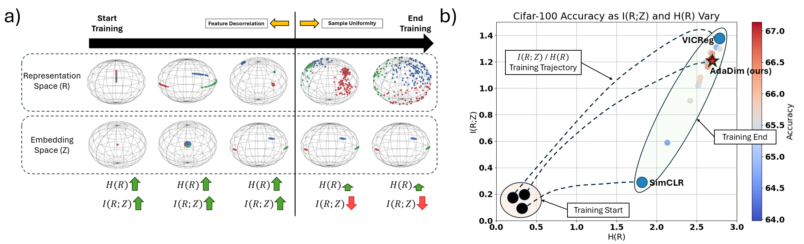
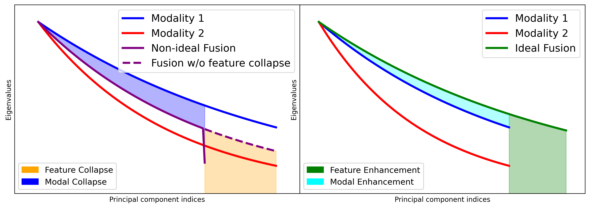
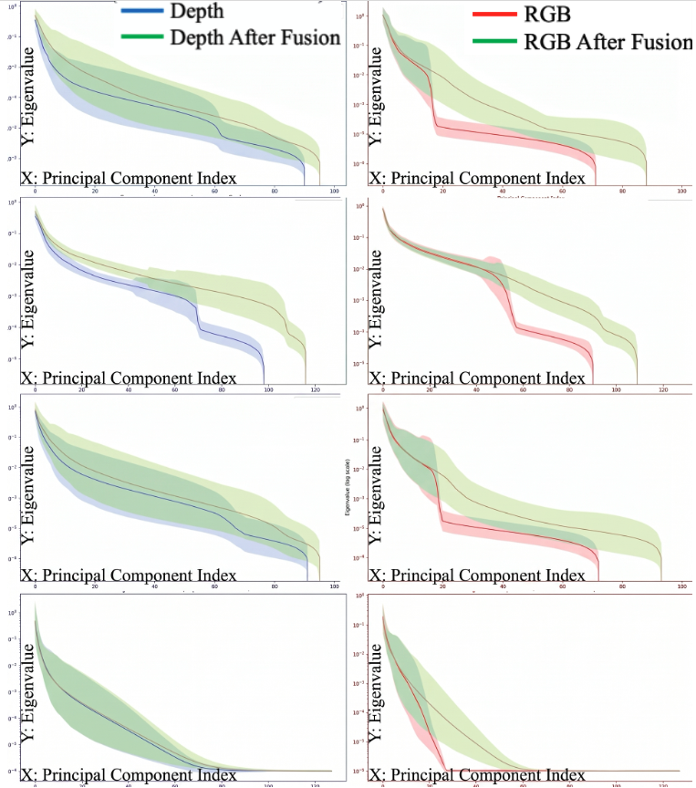
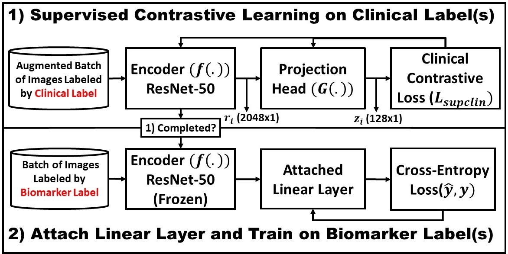
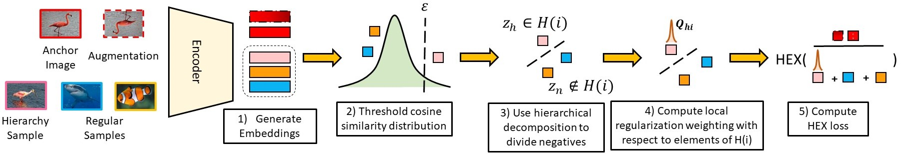
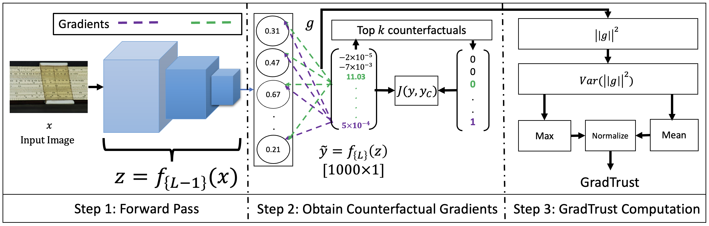
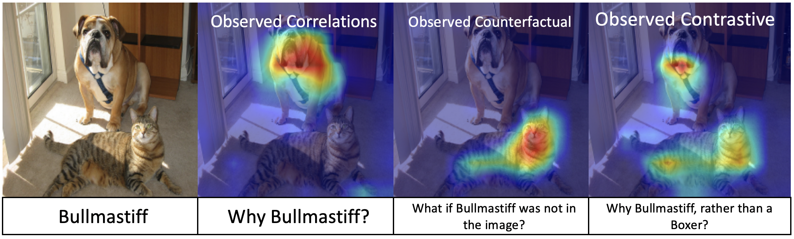
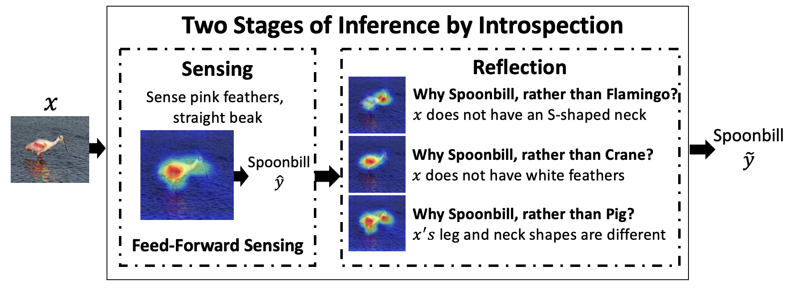
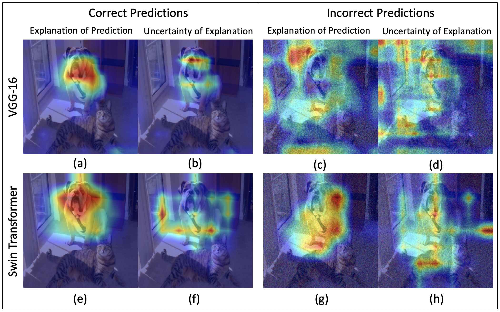

# Case studies connecting the lifecycle

[Back to the collection](../README.md) · [Figure plan](../assets/figures/README.md)

These concise guides follow the manuscript's worked examples. They summarize the role of each example, not numerical claims of superiority. Experimental details should be taken from the linked primary papers and author implementations.

## AdaDim

**Manuscript §2.5 · A priori · [Paper](../README.md#adadim)**

The representation `R` and the projector embedding `Z` evolve differently. The chapter examines representation entropy and encoder–projector mutual information and shows why a single end-of-training rank statistic is an incomplete picture. AdaDim adapts the balance between feature decorrelation and sample uniformity during training.

**Lifecycle lesson:** measure trajectories, not just endpoints. Retain checkpoints and compare downstream tasks at a common budget rather than choosing a model solely for its largest effective rank.

## R3D

**Manuscript §§3.5–3.6 · A priori / multimodal adaptation · [Paper](../README.md#r3d)**

Feature collapse is a loss of effective representation directions. Modal collapse is disproportionate reliance on one modality. These failures can occur independently. The Rank-enhancing Token Fuser (**RTF**) is the fusion component; **R3D** is the depth-informed action-anticipation framework that uses it.

**Lifecycle lesson:** check both the diversity of the fused representation and the contribution of each modality. Include unilateral sensor degradation and missing-modality tests before interpreting fusion gains as robustness.

## SAM, OCT, and seismic transfer

**Manuscript §§4.5–4.7 · A posteriori**

| Case | Resources | Lifecycle lesson |
| --- | --- | --- |
| Human and automated prompts for SAM | [SAM](../README.md#sam), [PointPrompt](../README.md#pointprompt), [prompt benchmark](../README.md#promptbenchmark) | Separate prompt quality, domain shift and fine-tuning effects; use matched interaction budgets |
| Clinical representation learning and biomarker heads | [Clinical OCT](../README.md#clinicaloct), [OLIVES](../README.md#olives) | Abundant clinical labels and scarce expert biomarker labels support different learning stages; prevent patient leakage |
| Geological fault delineation | [Fault benchmark](../README.md#faultbenchmark), [CRACKS](../README.md#cracks) | A shared backbone does not eliminate acquisition, preprocessing, label, or structural mismatch |

## HEX

**Manuscript §5.3 · Alignment motivation, a priori intervention · [Paper](../README.md#hex)**

Hierarchical groups emerge in SSL representations and can exhibit local collapse even when global statistics look healthy. HEX identifies such groups from similarity structure and adds hierarchy-aware regularization during SSL.

**Lifecycle lesson:** chapter context and intervention time are separate axes. A method discussed under alignment can still act during pretraining. Compare local and global structure and evaluate the downstream consequences of both.

## Visual editing and VOID

**Manuscript §§5.4–5.5 · A posteriori / inference-time intervention · [ObjectDrop](../README.md#objectdrop), [VOID](../README.md#void)**

Removing an object can require changing shadows, reflections, occlusions, motion, and later interactions. Preservation should therefore concern unaffected scene content rather than mechanically freezing every pixel outside the original object mask.

**Lifecycle lesson:** the validity of a change depends on the intervention. Evaluate removal efficacy, unaffected content, temporal consistency and physical plausibility. Generated counterfactuals are hypotheses about a scene, not proof that an identified latent feature is causal.

## Gradient diagnostics

**Manuscript Chapter 6 · Post hoc · [GradPurview](../README.md#gradpurview), [GradTrust](../README.md#gradtrust), [gradient anomaly detection](../README.md#gradanomaly)**

The manuscript contrasts what a trained model represents through activations with signals obtained by asking how its parameters would need to change under a chosen objective. GradPurview probes learned-capacity limitations. GradTrust uses counterfactual gradient statistics for prediction-trust ranking.

**Lifecycle lesson:** computing diagnostic gradients is distinct from applying weight updates. A detector needs an explicit scoring convention, validation protocol and response policy. Misprediction detection within a known distribution is also different from detecting a shifted distribution.

## Jailbreak evaluation and feedback

**Manuscript §6.5 · Post hoc to a posteriori · [HarmBench](../README.md#harmbench), [JailbreakBench](../README.md#jailbreakbench), [Llama Guard](../README.md#llamaguard)**

An aligned model may still fail under adversarial prompts or application context. Input/output screening provides runtime decisions; confirmed failures can later become training or preference examples.

**Lifecycle lesson:** a screen and a model update play different roles. Evaluate attack success and benign usefulness together, including [over-refusal](../README.md#xstest). Version the attack/evaluation protocol alongside each model release.

## Introspection

**Manuscript §7.3 · Post hoc features with auxiliary learning · [Paper](../README.md#introspective)**

The sensing model produces an initial prediction. Contrastive gradients encode alternatives, and a separately trained introspective predictor uses those features to revisit the decision.

**Lifecycle lesson:** transparency features can feed another decision mechanism, but that mechanism introduces its own training and validation requirements. It should be assessed against the original predictor under matched conditions.

## VOICE

**Manuscript §7.8 · Post hoc · [Paper](../README.md#voice)**

VOICE visualizes and quantifies uncertainty associated with gradient-based explanations using induced contrastive explanations. The repository keeps this formulation tied to the primary paper rather than reducing the method to generic input-perturbation saliency variance.

**Lifecycle lesson:** confidence in a prediction and confidence in its explanation are distinct. Explanations used in human review need their own uncertainty and faithfulness assessment.

 

## From detection to a validated update

An example workflow spanning the cases is: train representations with explicit collapse diagnostics; adapt a head or prompt protocol; detect uncertain or shifted outputs; inspect explanations and failure clusters; obtain reliable feedback; choose a targeted change; and retest the changed behavior together with a preservation suite.
